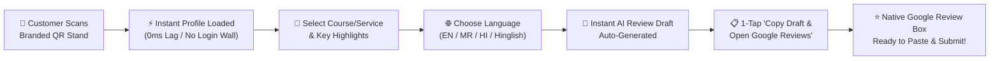

# 🌟 TrueReview — AI-Powered Google Review Automation SaaS

<div align="center">


**A high-converting, config-driven SaaS platform engineered to help local businesses collect authentic 5-star Google Reviews with zero customer friction.**

[🚀 View Live Demo](https://phoenixtechacademy.vercel.app/r/phoenix-tech) • [🖨️ View QR Stand](https://phoenixtechacademy.vercel.app/qr/phoenix-tech) • [📖 Architecture Docs](docs/ARCHITECTURE.md) • [🛡️ Policy Checklist](docs/GOOGLE_POLICY_CHECKLIST.md)

</div>

---

## ⚡ The Problem & The Solution

| The Traditional Way 🛑 | The TrueReview Way 🚀 |
| :--- | :--- |
| Customer scans generic QR code and lands on a static Google profile. | Customer scans branded QR and opens a personalized 5-second experience. |
| Customer has writer's block: *"I don't know what to write."* | 1-Tap AI Review Assistant generates structured feedback based on selected services. |
| Supported only in English. | Multilingual support in **English, Marathi (मराठी), Hindi (हिंदी), and Hinglish**. |
| Customer must manually find the "Review" tab, tap stars, and write. | **1-Tap Direct Deep Link** automatically pops open Google's 5-star review composer box. |
| Hardcoded websites require code deployment for each new client. | **100% Config-Driven Multi-Tenancy**: Add new businesses via Excel or config in 30 seconds. |

---

## 🔄 End-to-End User Conversion Flow



---

## ✨ Core Features

### 1. 🎯 Direct Google Review Box Modal Intent
- Bypasses static Google Search knowledge panels and mobile hash stripping.
- Uses canonical Places API intent (`https://search.google.com/local/writereview?placeid=<PLACE_ID>`) that natively triggers the 5-star rating selector and blank review comment area on Android and iOS devices.

### 2. 🤖 5-Second Multilingual AI Review Assistant
- Customers select what service they experienced (e.g., *MS-CIT Certification*, *Python & Coding*, *Web Development*) and what stood out (*Expert Faculty*, *Hands-on Lab*, *Personal Attention*).
- Instantly constructs an authentic, natural review in seconds without typing fatigue.
- Supports **English**, **Hinglish**, **मराठी (Marathi)**, and **हिंदी (Hindi)**.

### 3. 🖨️ Dynamic Printable Counter QR Stands
- Automatically generates high-resolution, vector-crisp rounded QR codes embedded with the business logo.
- Ready-to-print acrylic stand layout with call-to-action badges (`/qr/[slug]`).
- QR links point to permanent SaaS routes (`/r/[slug]`) so printed physical stands never break if Google Maps links change.

### 4. 🏢 Config-Driven Multi-Tenancy
- Zero code changes required to onboard new businesses.
- Centrally governed via `src/data/businesses.ts` and `TrueReview_Business_Registry.xlsx`.
- Automatically injects brand colors, custom logos, dynamic service chips, review highlights, and social touchpoints (Instagram, WhatsApp, Website, Facebook, vCard contact download).

### 5. 🛡️ 100% Google UGC Policy & Anti-Gating Compliant
- **Zero Review Gating:** Complies strictly with [Google Maps User Contributed Content Policies](https://support.google.com/contributionpolicy/answer/7400114).
- No sentiment screening, no conditional routing, no prohibited review incentives.
- Includes an optional private feedback loop for internal issue resolution without gating public reviews.

---

## 🏗️ Architecture & Tech Stack

```text
├── src/
│   ├── app/
│   │   ├── (auth)/             # Supabase Authentication (Login / Signup)
│   │   ├── (dashboard)/        # Business Owner Portal (QR Kits, Feedback, Analytics)
│   │   ├── api/public/         # High-speed public APIs for reviews, events, & business data
│   │   ├── qr/[slug]/          # Printable Tabletop/Counter Stand View
│   │   └── r/[slug]/           # Mobile-First Customer Review Experience
│   ├── components/ui/          # Modern UI Component Library
│   ├── data/businesses.ts      # Centralized Multi-Tenant Business Registry
│   ├── lib/
│   │   ├── ai-review-generator.ts # Deterministic & LLM review drafting engine
│   │   ├── rounded-qr.ts       # Canvas & SVG QR generation with embedded logo
│   │   └── supabase/           # Server and client Supabase connectors with RLS
│   └── types/                  # TypeScript Data Models & Database Schemas
├── supabase/migrations/        # PostgreSQL Schema & Row Level Security Policies
└── TrueReview_Business_Registry.xlsx # Master Client Onboarding Spreadsheet
```

| Layer | Technology | Purpose |
| :--- | :--- | :--- |
| **Framework** | Next.js 15 (App Router) | Server-side rendering, API routes, and optimal edge caching |
| **Language** | TypeScript (Strict Mode) | End-to-end type safety |
| **Styling** | Tailwind CSS + Vanilla CSS | Fluid micro-animations, glassmorphism, responsive mobile UI |
| **Database** | Supabase (PostgreSQL) | Multi-tenant relational storage with Row Level Security (RLS) |
| **Icons** | Lucide React | Minimal, modern icons |
| **Deployment** | Vercel | Global Edge Network hosting |

---

## 🚀 Quickstart & Local Development

### 1. Clone & Install Dependencies
```bash
git clone https://github.com/vivekgajdhane/google-review-automation.git
cd google-review-automation
npm install
```

### 2. Configure Environment Variables
Copy the template:
```bash
cp .env.example .env.local
```

Configure your credentials in `.env.local`:
```env
NEXT_PUBLIC_APP_URL="http://localhost:3000"
NEXT_PUBLIC_SUPABASE_URL="https://your-project.supabase.co"
NEXT_PUBLIC_SUPABASE_ANON_KEY="your-anon-key"
SUPABASE_SERVICE_ROLE_KEY="your-service-role-key"
```

*(Note: The platform includes instantaneous in-memory fallback. If Supabase keys are omitted, the application runs fully functional using the built-in registry).*

### 3. Run Development Server
```bash
npm run dev
```
Open [http://localhost:3000/r/phoenix-tech](http://localhost:3000/r/phoenix-tech) in your browser.

---

## ⚙️ Adding a New Business Client in 30 Seconds

To add a new business to the system:

1. Open `src/data/businesses.ts` (or update `TrueReview_Business_Registry.xlsx` and run `node scripts/sync-excel.mjs`).
2. Add a new client entry:
```typescript
"my-salon": {
  id: "salon-1",
  name: "Glow & Shine Salon",
  slug: "glow-shine",
  primaryColor: "#d946ef",
  accentColor: "#fdf4ff",
  googleReviewUrl: "https://search.google.com/local/writereview?placeid=<YOUR_PLACE_ID>",
  courseOptions: ["Hair Spa", "Facial & Cleanup", "Bridal Makeup"],
  highlightOptions: ["Expert Stylists", "Hygienic Ambiance", "Painless Service"]
}
```
3. Instantly visit `/r/glow-shine` — the custom-branded review page and QR kit are live immediately without redeploying code.

---

## 🧪 Testing & Validation

```bash
# Run unit & policy compliance tests
npm test

# Run TypeScript type validation
npm run typecheck

# Run ESLint quality gates
npm run lint

# Build production bundle
npm run build
```

---

## 📄 License
This project is licensed under the [MIT License](LICENSE).

---

<div align="center">
Built with ❤️ for Local Businesses • Powered by AI & Next.js
</div>
