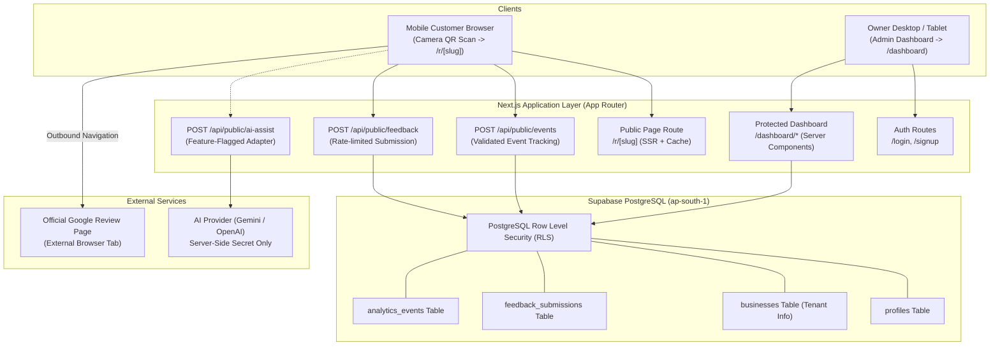

# System Architecture & Technical Specification: RCAFT

**Version:** 1.0  
**Stack:** Next.js 15 (App Router) + TypeScript + Tailwind CSS + Supabase (PostgreSQL + RLS + Auth)  
**Hosting Target:** Vercel (Edge/Serverless) + Supabase (AWS Mumbai / ap-south-1)  
**Date:** October 15, 2026  

---

## 1. High-Level Architecture Overview



---

## 2. Directory & Component Structure

```text
/
├── docs/                      # Architectural, policy, and research documentation
├── public/                    # Static assets, branding, and icons
├── src/
│   ├── app/                   # Next.js App Router
│   │   ├── (auth)/            # Auth group: /login, /signup, /auth/callback
│   │   ├── (dashboard)/       # Protected owner workspace: /dashboard/*
│   │   │   ├── layout.tsx     # Shell with navigation and tenant selector
│   │   │   ├── page.tsx       # Analytics & Overview
│   │   │   ├── business/      # Profile & Brand settings
│   │   │   ├── review-link/   # Google Review URL manager
│   │   │   ├── qr-code/       # Dynamic QR preview & download kit
│   │   │   ├── feedback/      # Private customer feedback list
│   │   │   └── settings/      # Retention, flags, data purge
│   │   ├── r/[slug]/          # High-speed public mobile page for customers
│   │   ├── api/               # Server-side API routes & actions
│   │   │   ├── public/events/ # Rate-limited click/scan tracker
│   │   │   ├── public/feedback/ # Validated feedback submission
│   │   │   └── public/ai-assist/ # Constrained LLM adapter (feature-flagged)
│   │   ├── layout.tsx         # Root layout with fonts and metadata
│   │   └── page.tsx           # Marketing homepage explaining ethical workflow
│   ├── components/            # Reusable UI primitives (buttons, cards, inputs)
│   │   ├── ui/                # Core accessible UI components
│   │   ├── public/            # Public customer action cards and forms
│   │   └── dashboard/         # Dashboard metrics cards, charts, QR views
│   ├── lib/                   # Shared utilities, DB client, Zod schemas
│   │   ├── supabase/          # Supabase browser, server, and admin clients
│   │   ├── ai/                # AI Provider interface and Gemini/OpenAI adapter
│   │   ├── qr/                # QR SVG/PNG generation utilities
│   │   ├── validations/       # Zod schemas for forms and APIs
│   │   └── env.ts             # Strict environment variable validation
│   └── types/                 # Database and domain TypeScript definitions
├── supabase/
│   └── migrations/            # SQL migration files with RLS policies
├── package.json
├── tsconfig.json
└── README.md
```

---

## 3. Technology Stack & Component Justifications

1. **Framework:** Next.js 15 (App Router)
   - Server Components ensure that sensitive database keys and AI provider secrets never ship to the client.
   - Built-in metadata, open-graph tags, and font optimization provide instant loading on mobile devices.
2. **Database & Auth:** Supabase PostgreSQL + Supabase Auth
   - Native Row Level Security (RLS) policies prevent cross-tenant data leaks at the database level.
   - Built-in session token rotation and secure HTTP-only cookies.
3. **Styling:** Tailwind CSS + Accessible Primitives
   - Lightweight, responsive styling with clean mobile ergonomics.
   - High contrast, minimum 44px touch targets on mobile public flows.
4. **QR Generation:** maintained `qrcode` package
   - Generates vector SVG for crisp 300 DPI counter stand printing and high-res PNG for digital downloads.
5. **AI Module Interface (`IAIAssistProvider`):**
   - Clean abstraction separating application code from vendor APIs (Google Gemini or OpenAI). Server-side only, validated with Zod.
