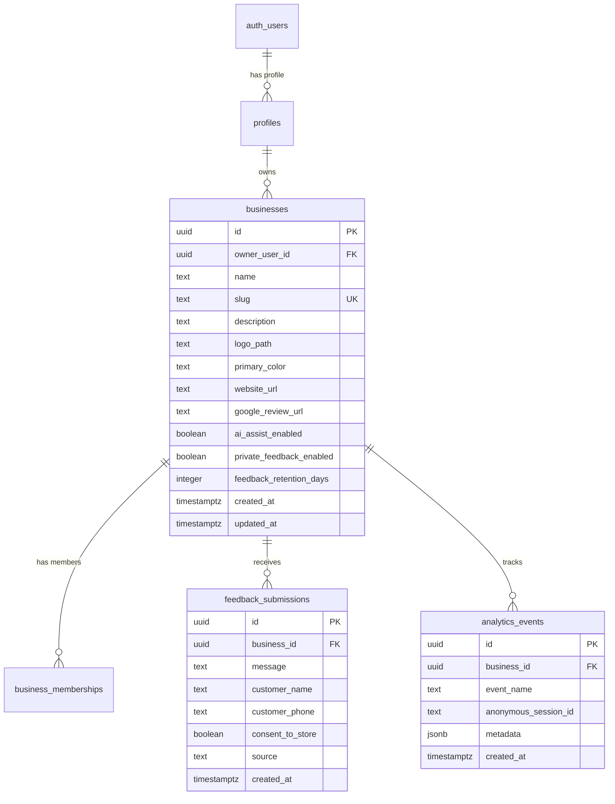

# Database Schema & Security Specification: RCAFT

**Database Engine:** PostgreSQL 15+ (Supabase)  
**Security Model:** Mandatory PostgreSQL Row Level Security (RLS) on all tenant tables  
**Region Target:** AWS Mumbai (`ap-south-1`)  
**Date:** October 15, 2026  

---

## 1. Entity Relationship Diagram (ERD)



---

## 2. Table Specifications & DDL

### Table: `profiles`
```sql
CREATE TABLE public.profiles (
    id UUID PRIMARY KEY REFERENCES auth.users(id) ON DELETE CASCADE,
    display_name TEXT,
    email TEXT,
    created_at TIMESTAMPTZ NOT NULL DEFAULT timezone('utc'::text, now()),
    updated_at TIMESTAMPTZ NOT NULL DEFAULT timezone('utc'::text, now())
);
```

### Table: `businesses`
```sql
CREATE TABLE public.businesses (
    id UUID PRIMARY KEY DEFAULT gen_random_uuid(),
    owner_user_id UUID NOT NULL REFERENCES auth.users(id) ON DELETE RESTRICT,
    name TEXT NOT NULL CHECK (char_length(name) >= 2 AND char_length(name) <= 100),
    slug TEXT NOT NULL UNIQUE CHECK (slug ~* '^[a-z0-9]+(-[a-z0-9]+)*$' AND char_length(slug) >= 3 AND char_length(slug) <= 50),
    description TEXT,
    logo_path TEXT,
    primary_color TEXT DEFAULT '#2563EB' CHECK (primary_color ~* '^#[0-9a-f]{6}$'),
    website_url TEXT,
    google_review_url TEXT,
    ai_assist_enabled BOOLEAN NOT NULL DEFAULT false,
    private_feedback_enabled BOOLEAN NOT NULL DEFAULT true,
    feedback_retention_days INTEGER NOT NULL DEFAULT 90 CHECK (feedback_retention_days >= 7 AND feedback_retention_days <= 365),
    created_at TIMESTAMPTZ NOT NULL DEFAULT timezone('utc'::text, now()),
    updated_at TIMESTAMPTZ NOT NULL DEFAULT timezone('utc'::text, now())
);

CREATE INDEX idx_businesses_slug ON public.businesses (slug);
CREATE INDEX idx_businesses_owner ON public.businesses (owner_user_id);
```

### Table: `business_memberships`
```sql
CREATE TYPE public.business_role AS ENUM ('owner', 'manager', 'staff');

CREATE TABLE public.business_memberships (
    id UUID PRIMARY KEY DEFAULT gen_random_uuid(),
    business_id UUID NOT NULL REFERENCES public.businesses(id) ON DELETE CASCADE,
    user_id UUID NOT NULL REFERENCES auth.users(id) ON DELETE CASCADE,
    role public.business_role NOT NULL DEFAULT 'manager',
    created_at TIMESTAMPTZ NOT NULL DEFAULT timezone('utc'::text, now()),
    UNIQUE(business_id, user_id)
);

CREATE INDEX idx_memberships_user ON public.business_memberships (user_id);
```

### Table: `feedback_submissions`
```sql
CREATE TABLE public.feedback_submissions (
    id UUID PRIMARY KEY DEFAULT gen_random_uuid(),
    business_id UUID NOT NULL REFERENCES public.businesses(id) ON DELETE CASCADE,
    message TEXT NOT NULL CHECK (char_length(message) >= 2 AND char_length(message) <= 2000),
    customer_name TEXT CHECK (char_length(customer_name) <= 100),
    customer_phone TEXT CHECK (char_length(customer_phone) <= 20),
    consent_to_store BOOLEAN NOT NULL DEFAULT true,
    source TEXT NOT NULL DEFAULT 'qr_public_page',
    created_at TIMESTAMPTZ NOT NULL DEFAULT timezone('utc'::text, now())
);

CREATE INDEX idx_feedback_business_created ON public.feedback_submissions (business_id, created_at DESC);
```

### Table: `analytics_events`
```sql
CREATE TABLE public.analytics_events (
    id UUID PRIMARY KEY DEFAULT gen_random_uuid(),
    business_id UUID NOT NULL REFERENCES public.businesses(id) ON DELETE CASCADE,
    event_name TEXT NOT NULL CHECK (
        event_name IN (
            'public_page_view',
            'private_feedback_started',
            'private_feedback_submitted',
            'ai_assist_requested',
            'ai_assist_completed',
            'google_review_link_clicked',
            'qr_downloaded'
        )
    ),
    anonymous_session_id TEXT CHECK (char_length(anonymous_session_id) <= 64),
    metadata JSONB DEFAULT '{}'::jsonb,
    created_at TIMESTAMPTZ NOT NULL DEFAULT timezone('utc'::text, now())
);

CREATE INDEX idx_analytics_business_event_created ON public.analytics_events (business_id, event_name, created_at DESC);
```

---

## 3. PostgreSQL Row Level Security (RLS) Policies

All tables have RLS enabled:
`ALTER TABLE [table_name] ENABLE ROW LEVEL SECURITY;`

### 1. `profiles` RLS
- **SELECT / UPDATE:** `auth.uid() = id` (User can only read and edit their own profile).

### 2. `businesses` RLS
- **SELECT (Public):** Anonymous users can read public business fields required to render `/r/[slug]`:
  ```sql
  CREATE POLICY "Public can view active business profiles by slug"
  ON public.businesses FOR SELECT
  USING (true);
  ```
- **INSERT / UPDATE / DELETE (Owner):** Only authenticated owners can modify their business:
  ```sql
  CREATE POLICY "Owners can manage their own businesses"
  ON public.businesses FOR ALL
  TO authenticated
  USING (owner_user_id = auth.uid())
  WITH CHECK (owner_user_id = auth.uid());
  ```

### 3. `feedback_submissions` RLS
- **INSERT (Public):** Anyone can submit private feedback via the public form:
  ```sql
  CREATE POLICY "Public can submit private feedback"
  ON public.feedback_submissions FOR INSERT
  WITH CHECK (
    EXISTS (
      SELECT 1 FROM public.businesses b 
      WHERE b.id = business_id AND b.private_feedback_enabled = true
    )
  );
  ```
- **SELECT / DELETE (Owner only):**
  ```sql
  CREATE POLICY "Owners can view and delete feedback for their business"
  ON public.feedback_submissions FOR ALL
  TO authenticated
  USING (
    EXISTS (
      SELECT 1 FROM public.businesses b
      WHERE b.id = feedback_submissions.business_id AND b.owner_user_id = auth.uid()
    )
  );
  ```

### 4. `analytics_events` RLS
- **INSERT (Public):**
  ```sql
  CREATE POLICY "Public can log permitted analytics events"
  ON public.analytics_events FOR INSERT
  WITH CHECK (
    EXISTS (SELECT 1 FROM public.businesses b WHERE b.id = business_id)
  );
  ```
- **SELECT (Owner only):**
  ```sql
  CREATE POLICY "Owners can query analytics for their business"
  ON public.analytics_events FOR SELECT
  TO authenticated
  USING (
    EXISTS (
      SELECT 1 FROM public.businesses b
      WHERE b.id = analytics_events.business_id AND b.owner_user_id = auth.uid()
    )
  );
  ```
