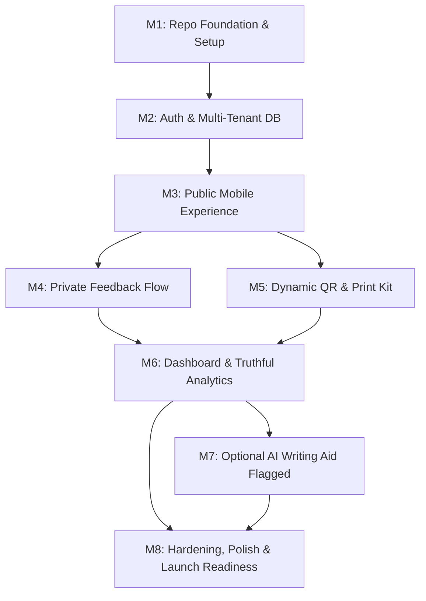

# MVP Roadmap & Implementation Plan: RCAFT

**Product:** RCAFT MVP  
**Execution Paradigm:** Small, verified, test-driven slices following Antigravity IDE Engineering Principles  
**Status:** Stage A Plan (Pending `CONTINUE TO MVP` approval)  

---

## 1. Milestone Breakdown (Post Stage A)

---

### Milestone 1 — Repository Foundation & Architecture
- **Scope:** 
  - Initialize Next.js 15 (App Router) + TypeScript project with Tailwind CSS.
  - Set up strict environment validation with Zod (`src/env.ts`).
  - Configure design system, accessible UI primitives, and layout shells.
  - Setup ESLint, Prettier, and local test runners.
  - Document quickstart and verification scripts in `README.md`.
- **Done When:** Clean local start (`npm run dev`), typecheck passes (`tsc --noEmit`), build passes, `.env.example` created.

---

### Milestone 2 — Authentication & Multi-Tenant Database
- **Scope:**
  - Supabase client and server configuration (`@supabase/ssr`).
  - Database migrations for `profiles`, `businesses`, `business_memberships`, `feedback_submissions`, `analytics_events`.
  - PostgreSQL Row Level Security (RLS) policies enforcing strict tenant isolation.
  - Owner signup, login, session management, and protected `/dashboard` layout.
  - Business profile creation, slug generation, and Google Review URL settings.
- **Done When:** Authenticated owner can create/edit a business; cannot read or modify any other owner's business; RLS verified via automated unit/integration test.

---

### Milestone 3 — Public Mobile Experience (`/r/[slug]`)
- **Scope:**
  - Build high-speed, mobile-first public page (`/r/[slug]`).
  - Server-side slug validation and business branding fetch.
  - Render two equal, unconditioned action cards: "Open Google Review Page" & "Send Private Feedback".
  - Outbound link handler that securely opens official Google URL and triggers non-blocking `/api/public/events` click record.
  - Zero sentiment screening, no staff prompting, no incentive banners.
- **Done When:** Anonymous visitor loads page in < 800ms, both options are visible simultaneously, clicking Google records `google_review_link_clicked` and opens the verified URL.

---

### Milestone 4 — Private Feedback Channel
- **Scope:**
  - Short, respectful private feedback modal/form on public page.
  - Form fields: voluntary message textarea, optional customer contact info, consent disclosure checkbox.
  - Server-side submission route (`/api/public/feedback`) with rate limiting and input validation.
  - Owner dashboard feedback list with date filters and permanent deletion action.
- **Done When:** Anonymous customer can submit feedback without login; data stored securely; owner can read and delete feedback in dashboard; cross-tenant access denied.

---

### Milestone 5 — Dynamic QR Generator & Print Kit
- **Scope:**
  - Client/server QR generation library (`qrcode`) pointing to canonical `/r/[slug]`.
  - Export to SVG (vector print) and high-res PNG (digital/screen).
  - Printable counter card generator (A6 / 4x6 tabletop format) with policy-compliant copy.
  - Instructions for counter placement and test scanning.
- **Done When:** Downloaded SVG/PNG successfully scanned by mobile camera and correctly resolves to the tenant's public landing page.

---

### Milestone 6 — Truthful Analytics Dashboard
- **Scope:**
  - Analytics aggregate view: Page Scans, Feedback Started, Feedback Submitted, Google Link Clicks, QR Downloads.
  - Funnel conversion percentage calculations with clear denominators.
  - Prominent explanatory callouts preventing false claims (e.g. clarifying that a click is not a published review).
  - Timeframe filter (Last 7 days, 30 days, All time).
- **Done When:** Dashboard displays accurate metrics matching database events with zero data leakage between businesses.

---

### Milestone 7 — Optional AI Writing Aid (Feature-Flagged)
- **Scope:**
  - Gated behind `ENABLE_AI_REVIEW_ASSIST=false` (default OFF).
  - Server-side LLM provider adapter (Gemini 2.5/Flash or OpenAI) behind interface `IAIAssistProvider`.
  - Strict guardrail prompt: grammar and clarity editing only, zero factual additions, zero staff names, retain negative/neutral sentiment.
  - Client UI: customer voluntary trigger, original vs. suggested preview, manual copy button, try again, discard.
  - Rate limiting (5 requests/hour per session) and error fallback.
- **Done When:** AI assists customer text without altering sentiment or inventing facts; works fully when enabled; application remains 100% functional when flag is disabled.

---

### Milestone 8 — Hardening, Polish & Launch Readiness
- **Scope:**
  - Accessibility pass (WCAG AA compliance, focus rings, contrast).
  - Edge cases: reserved slugs, invalid Google URLs, offline QR scan handling, network error states.
  - Security audit: CSRF, HTTP security headers, sanitized text rendering, zero PII logging.
  - Seed fixture for demo business (e.g., *"The Pune Hair Lounge, Baner"*).
  - Final documentation update and `docs/LAUNCH_CHECKLIST.md`.
- **Done When:** Full test suite passes; production build succeeds; demo walkthrough verified.

---

## 2. Explicit Exclusions (Post-MVP Roadmap)

The following items are intentionally **excluded** from the MVP to preserve simplicity, focus, and legal compliance:
- **No Payment Gateways in MVP:** Razorpay integration will be evaluated only after 10–15 paid pilot commitments. Manual billing/invoicing suffices for early pilots.
- **No Direct Google Review Publishing:** Technically impossible for consumer reviews and prohibited by Google API policies.
- **No Automated SMS/WhatsApp Blasts:** Avoids expensive TRAI DLT compliance registration and spam liabilities.
- **No Review Gating / Star-Rating Filters:** Permanent architectural exclusion to guarantee 100% Google policy compliance.
- **No Multi-Branch Enterprise Portals:** Kept simple for single-location owners in initial launch.
- **No Native iOS/Android Apps:** Web responsive PWA/mobile site covers 100% of QR scan workflows without app store friction.
